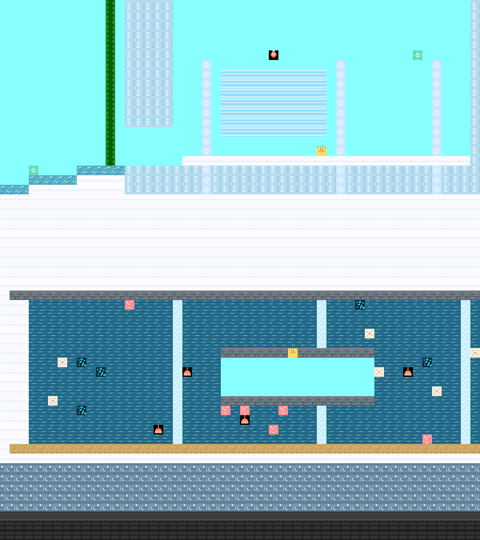
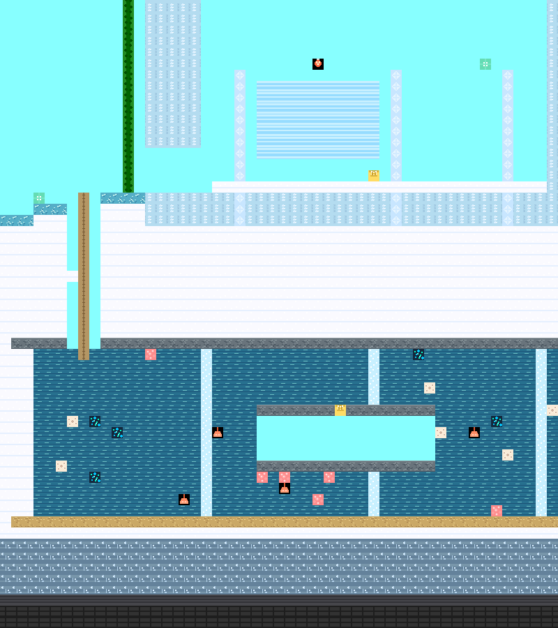

# A73：地下湖入口、实体落脚点与检查点返程

## 问题与修复

像素启程已有地下湖、气室、气泡柱和检查点，却没有经验证的地表入口。旧布局在湖顶y25铺石层，以上是冰区雪层。完整身体静态候选从西侧地表到湖水、气室及检查点屋顶均断连；30/60/144 FPS相同正常输入尝试下降，20.067/20.033/20.008秒都停在地表y38.9，水体接触和攀爬步数均0。证据为[首轮旧图](evidence/2026-11-12_lake_before.json)和[最终控制器旧图](evidence/2026-11-12_lake_final_controller_before.json)。静态筛查保持有限范围说明，真实输入不扩大为穷举所有路线。

最终只改41格：x263–265开窄竖井，x264y24–38放原有绳索，并保留原雪块(263,31)供中途落脚恢复。原33雪/3石/3冰/1水/1空气变成26空气和15绳索。气室、珊瑚、原气泡柱和检查点未改；冰宫已修门槛、原藤蔓及原角色/物理参数不变。布局单独存储于[maps/pixel_journey/lake_connections.json](../../maps/pixel_journey/lake_connections.json)，启动加载。全部逐格差异并入严格版本夹具，地图3累计372格已审查差异，其余差异不放行。

两图按实际16px方块绘制；已查看竖井、保留雪阶和原湖体范围。截图不代替实际路线验证。

## 测试路线与过程失误

局部夹具明确从(261.5,38.9)开始，和原森林出生严格区分：降井→湖顶下向东游→气室西侧下降→保持向上游泳输入直到进入干燥气室落地→西侧出室上游→原检查点屋顶落地恢复→向西返回→爬井至雪阶上方→松开攀爬落在原雪块恢复→再攀爬、空格跳离井口→地表恢复。

共享实际输入控制器增加`swim`高度目标，以及入气室时可选`swim_height`；仍只使用实际W/S、A/D和Space事件，未增加游戏机制或直接移动角色。保持S时解除气泡柱攀爬，W继续按现有规则上游。路线数据在[scripts/routes/pixel_underground_lake.json](../../scripts/routes/pixel_underground_lake.json)。

原气室两侧本来开放，不能把它误报为封闭房间。初次候选到西侧口后撤去W，下沉到气室底板下面，随后控制器尝试上跳；且错误要求恢复到195，而该图原上限是100。失败记录[首个竖井候选](evidence/2026-11-12_lake_shaft_candidate.json)保留，修正实际输入和恢复目标，不改物理或气室。

第二次虽进气室、激活检查点，却爬完全井只剩14.243体力，且返回目标较低使控制器没有发出脱绳跳跃，落回湖内：[原始记录](evidence/2026-11-12_lake_dry_entry_candidate.json)。因此保留一格原雪层作实体恢复点，并明确在井口跳出后横移；没有把悬挂误作恢复，也没有降低跳跃消耗。[雪阶候选](evidence/2026-11-12_lake_rest_step_candidate.json)在60 FPS首次完整返回；之后[局部三档候选](evidence/2026-11-12_lake_final_candidate.json)和[原森林三档候选](evidence/2026-11-12_lake_normal_candidate.json)均通过。候选的“清整片再恢复雪块”和正式分段清除JSON已逐格比对等价。

## 正式生产布局结果

正式原始数据快照0489107，[局部](evidence/2026-11-12_lake_after.json)、[原森林连续](evidence/2026-11-12_lake_normal_after.json)。各条首次路线末端才单独施加1000致命伤，实际WorldSession复活一次后在同一会话继续正常输入返程；没有复制角色状态或重设坐标。

| 出生范围 | FPS | 首次完整返回/秒 | 最低HP | 最低体力 | 复活后再次返回/秒 |
| --- | ---: | ---: | ---: | ---: | ---: |
| 局部地表 | 30 | 54.200 | 150 | 31.893 | 30.933 |
| 局部地表 | 60 | 53.433 | 150 | 33.056 | 30.483 |
| 局部地表 | 144 | 54.192 | 150 | 33.229 | 30.367 |
| 原森林连续 | 30 | 105.000 | 136.824 | 31.269 | 30.933 |
| 原森林连续 | 60 | 103.950 | 136.824 | 32.477 | 30.483 |
| 原森林连续 | 144 | 103.633 | 136.770 | 32.634 | 30.358 |

原森林保留原出生(15.5,54.9)，经原T5、两次增强跳跃和上云台，再到原东岛并落在湖西地表，始终同一实际会话。现有藤蔓伤害保留；首次全程自然复活0。每档均实际接触302并保存湖内屋顶y20.9；致命伤后合法、存活、恰好复活1次，随后正常返回无再次复活，最低体力34.8以上、末端至少95。

局部路线实际游泳接触2678–2776物理步、干燥气室站立47–52步，原雪阶实际站立并恢复至少95；局部单物理步最大横移0.0421、竖移0.2224以下。原森林整体最大位移包括原T5正常传送，不能套用“无大位移”的局部结论。气室到达时已满体力，站立证据不等同于测得该室恢复量；雪阶则有33左右到95的实际恢复记录。

选择页描述补上冰宫西井入口提示，21号字宽777/可用852，已查看[完整选择页](evidence/ui/pixel_lake_route_hint.png)。保留森林/天空/冰宫/金字塔/高塔路线、借台休息和空格跳离提示，不挤出边界。

## 回归与边界

局部/原森林两条三档路线、实际复活后返程、严格地图逐格差异和冰宫三项，共6项定向回归44.094秒通过：[日志](evidence/regressions/lake_targeted_routes.txt)。新增路线回归在子进程加载地图，保持主测试进程懒加载约束。

完整273项回归以a7dd2d8启动，当前运行中；结果确认后补充，不提前标为通过。先前完整271项基线仍有效于其e54bcd2快照。

本阶段不声称覆盖地下湖东半、每株珊瑚、所有下潜/上岸接缝或实体设备手感。继续检查其他既有区域和交互组合；没有新增玩法。按文件小步提交，完整验证及过程记录结束后阶段SSH推送。
