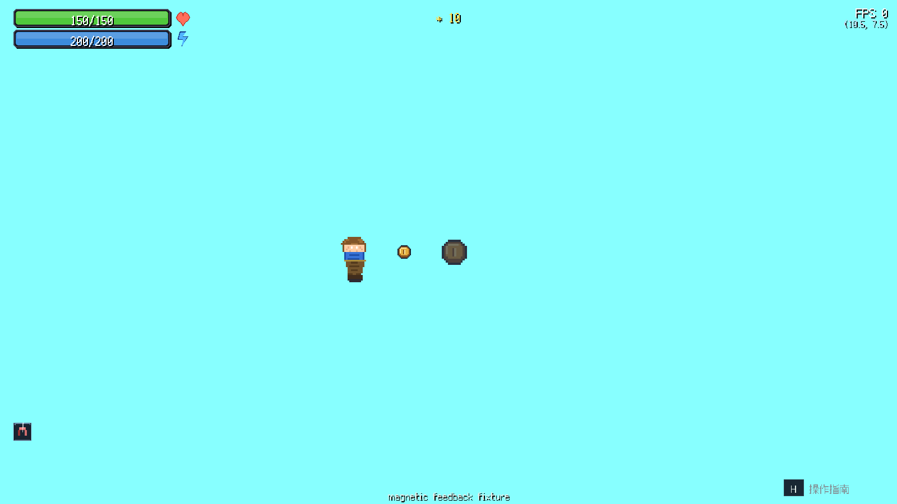

# A78：让磁引Buff产生实际拾取行为

## 用户要求与本轮界限

用户明确方块通过Buff承载效果、两者深度绑定是核心设计，允许必要新增方块/Buff。本轮从58项声明、关联方块和消费路径开始审计，[初始清单](evidence/2026-11-12_buff_contract_inventory_initial.json)每项明确为本清单尚未行为验收；静态代码线索、图标及早前1392组不变量矩阵都不等于效果实现。已存在的发光渲染、恢复/伤害等自动化行为证据也不应误报为缺失。

优先处理磁引14：它声明自动吸引附近掉落物，原代码没有拾取消费路径，目录也没有关联来源方块。本轮先兑现现有十种非实体积分拾取物的吸引与收取，来源链继续下一阶段补齐；当前没有通用背包/松散掉落物系统，不冒称这些系统或58项效果全部完成。

## 可重复前后数据

[初测](evidence/2026-11-12_buff14_pickup_initial_probe.json)显示Buff14确实激活，但距身体0.1格的积分物两秒内无动作。随后[正式控制器](../../scripts/audit_magnetic_pickups.py)以真实WorldSession验证十种拾取物310–319、左右镜像、30/60/144 FPS、激活/无Buff对照，共120组；局部夹具明确注入Buff、零重力固定位置，不代表正常地图来源。

- [修复前](evidence/2026-11-12_magnetic_pickups_before.json)：60组激活均未吸取，60组对照也未吸取。
- [修复后](evidence/2026-11-12_magnetic_pickups_after.json)，行为快照6891a97：60组激活全部收取正确积分并变为对应已拾取状态，60组对照不变；120组位置保持(5.5,4.5)、无错误/复活。

收取后的实际移动重访不会重复计分；循环坐标按最短距离吸引、规范格去重，两个独立会话和模板互不共享消耗。

## Buff效果路径与数据保持

原Buff tick只处理角色自身，无法访问附近世界对象。现在Buff效果处理器接受可选世界上下文，WorldSession绑定当前世界，磁引由Buff的`magnetic`处理器执行。保留原单参数tick调用兼容旧Player覆盖；本地时间/属性效果继续原接口。

`magnetic_pickups.py`负责范围与视线，默认4格，实例首参数可指定半径，上限16；负半径视为0，非有限参数不启动扫描。约每0.1秒扫描，并以规范坐标和最短循环距离去重；实体墙和封闭对角阻断吸引，避免从封闭奖励室隔墙拿物品。视线逐格遍历，不用可能漏掉薄对角交集的固定距离采样。

`pickup_effects.py`集中接触与Buff收取交易：读取实际当前方块、先写已拾取状态再发布一次积分，沿用现有奖励数据和消耗标记。物品没有可消耗状态时不允许磁引反复收获。既有方块属性与58项Buff目录没有修改，其他旧`special`处理尚未全部迁移，不能据此称全体系数据改造已完成。

动画记录归属角色，用模拟时间插值到角色位置；积分在成功认领时结算，飞行动画是反馈而非额外一份物品。到期/移除后不再吸新物，已结算动画短时完成并清理；复活清空旧动画。最多64条反馈、每图标最大32px并先裁剪屏外目标，极端缩放不分配巨型图像。暂停/失焦冻结模拟时间，动画也冻结。磁引是被动计时效果，眩晕阻止主动动作时仍按时间生效；其他交互限制的功能审计另行展开。

## 实际WorldView画面

[捕捉脚本](../../scripts/capture_magnetic_pickups.py)运行实际GameApp页面绘制、WorldSession和WorldView，SDL dummy下直接注入Buff。原币310在首个物理步变为320，积分0→10；0.1167秒币飞向角色，0.5秒反馈数量清零，积分仍10。[完整记录](evidence/2026-11-12_magnetic_worldview.json)及[飞行中](evidence/2026-11-12_magnetic_worldview_flying.png)/[结束](evidence/2026-11-12_magnetic_worldview_settled.png)已查看。

初次图像在0.375秒标为settled，但动画从0.0083秒开始、持续0.375秒，当时仍未结束；[初次原始记录](evidence/2026-11-12_magnetic_worldview_initial.json)和原图保留，最终增加0.5秒确认清理。这是采样标签/时点修正，没有为得到结果改动画时长。上述画面不是实体设备或正常来源路线验收。

## 回归、失败与下一步

50项既有状态/玩法/视觉/横向攀爬回归11.912秒通过，[日志](evidence/regressions/magnetic_existing_effects_targeted.txt)。新增五项行为回归3.911秒通过，[日志](evidence/regressions/magnetic_behavior_targeted.txt)，覆盖120组前述行为、重访不重复计分、半径/墙/角、循环与独立会话、到期/清除/复活/暂停/失焦/眩晕、像素反馈/清理及极端范围/缩放上限。

初次独立性用例把同一个显式可变World当模板传给两个会话，产生一项失败：[原日志](evidence/regressions/magnetic_behavior_initial_fixture.txt)。生产`get_map`负责克隆，显式夹具覆盖则直接接收给定World；修正夹具显式克隆并断言对象不同，生产地图工厂未改。没有把测试器共享对象误报成生产模板污染。

0fdf8f0完整284项回归457.261秒通过：[全量日志](evidence/regressions/284_magnetic_buff_behavior_and_context.txt)。期间仅增加过程记录与独立审计数据，生产代码未再变化。阶段验证与过程记录完成后小步归档并SSH推送，随后立即补磁引的方块来源和正常可达触发路线，再逐项推进其他Buff。已有58项清单保留未验收项，不以本轮一个效果修复代替全体系完成。

58项持续审计见[工作清单](2026-11-12_Buff功能审计工作清单.md)。另已在既有战斗API实测狂暴47只扣血而未增攻击/结算伤害：[原始数据](evidence/2026-11-12_berserk_partial_function_probe.json)。该问题未在本轮修好，磁引来源补齐后优先推进，不因全量通过忽略声明缺口。
