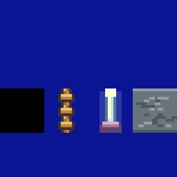

# A77：既有绳索、末地烛和图鉴透明合成

本轮收尾既定像素素材修整。用户随后明确要求优先审计Buff说明与实际功能、强调方块通过Buff承载效果，并授权必要的新方块/Buff；已记入AGENTS，当前素材验证完成后立即转入该项工作。早前1392组不变量矩阵不代表58个效果都已兑现。

## 实测与修改

绳索31原为整格土黄色底、末地烛96原为黑底，均非实体。三种原生World背景上，显式透明合成0/6；[原始数据](evidence/2026-11-12_rope_endrod_before.json)还记录当前15图486格绳索，末地烛未被当前地图放置，仅在素材库可见。不将后者冒称地图修复。

保留16×16像素风格，绳索改为有明暗编织和绳结的透明窄轮廓；末地烛改为亮色灯芯、淡光晕和紫色底座。实际目录只有31和96两个`pattern`字段发生变化，全部359方块玩法字段、58 Buff和此前其他素材保持不变。统一生成器登记审查哈希，图集使用新的A77文件名，不覆盖历史证据。

三背景原生World材质复核6/6透明正确，实体黑色对照保留：[结果](evidence/2026-11-12_rope_endrod_after.json)。已查看[前](evidence/art/rope_endrod_before_11.png)/[后](evidence/art/rope_endrod_after_11.png)和[实际地下湖绳井](evidence/art/A77_lake_rope_after.png)。原黑色/褐色整格背景不再遮挡其后地形。

## 图鉴实际显示故障

ReferenceBrowser缓存图像时，先用方块色填满画布再叠加透明图案，导致此前32种透明素材在图鉴重新变成色块。[实际卡片测试器](../../scripts/audit_reference_alpha.py)使用真实缓存输出贴到现有卡片底色，修复前0/32通过；原生World通过不能代替这个UI路径。

缓存对显式RGBA透明画布保留alpha，再叠加图案；普通方块和Buff图标继续原路径。修复后原32种及新增的2种透明图案34/34通过，实体黑色仍为不透明黑。[前](evidence/2026-11-12_reference_alpha_before.json)/[后](evidence/2026-11-12_reference_alpha_after.json)原始数据及[实际卡片图像](evidence/2026-11-12_reference_alpha_after.png)留档并已查看。没有把全局黑色当透明键。

离线预览重新生成，仅地图4/5/7/8/9的出生视图像素变化并分别提交；其他10图预览相同。源图块数量/位置、碰撞和攀爬规则不变。

## 验证与下一优先级

严格359方块/58 Buff目录、非艺术字段、原生透明合成/拾取状态、图鉴导航及缓存预算，共15项定向回归3.254秒通过：[日志](evidence/regressions/rope_endrod_catalog_ui_targeted.txt)。本轮为低影响素材/显示修复，使用既有回归及独立前后测量，没有增加重复实现的测试方法。

c5d2afc完整279项回归正在运行，结果确认后补记；先前cddcd96完整279项453.987秒保留其快照边界。以上图像是原生离屏绘制，尚非实体设备验收。

当前阶段推送后，以“方块触发→Buff施加→实际效果→到期/清理”为主线逐项审计。对缺少消费路径、仅API有实现但游戏不可触达、行为与说明不符分别记录实测和范围；优先让现有效果确实可用，再按需要扩展关联机制和内容。
